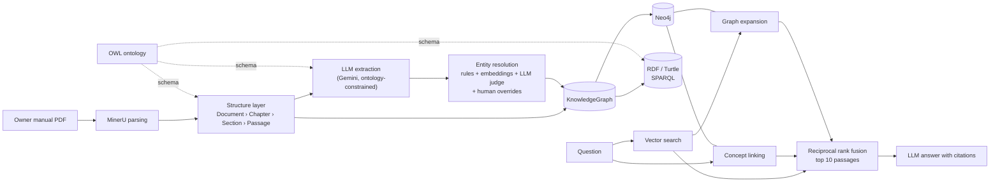
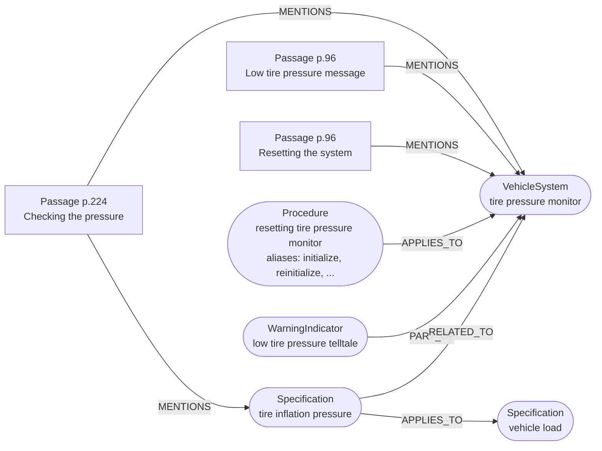

# Automotive Knowledge Graph & GraphRAG

Turns vehicle owner manuals (PDF) into an **ontology-driven knowledge graph** and uses it for
**GraphRAG** retrieval: an LLM agent answers questions with cited passages, and the graph supplies
context that plain vector search misses.

- **Ontology first:** an OWL ontology defines the schema; the code, Neo4j and the RDF export all follow it, and a test fails if they drift apart.
- **Two stores, one model:** a Neo4j property graph for retrieval and agent tools, plus an RDF/Turtle export for SPARQL and standards-based exchange.
- **LLM extraction under control:** Gemini may only return ontology types (structured output); results are cached per passage; duplicate concepts are merged by rules, embeddings and an LLM judge, with human overrides.
- **Measured, not assumed:** a retrieval benchmark compares GraphRAG against the metadata-filtered vector baseline on identical passages.

## Architecture



## Ontology

Defined in [`ontology/automotive.ttl`](ontology/automotive.ttl) (OWL), mirrored in [`src/graph/ontology.py`](src/graph/ontology.py).

| Layer | Classes | Relations |
|---|---|---|
| Structure (rule-based, no LLM) | `Document`, `Chapter`, `Section`, `Passage` | `HAS_CHAPTER`, `HAS_SECTION`, `HAS_PASSAGE`, `NEXT_PASSAGE` |
| Domain (LLM-extracted) | `VehicleSystem`, `Component`, `Feature`, `WarningIndicator`, `Procedure`, `MaintenanceTask`, `SafetyInstruction`, `Specification` | `PART_OF` (transitive), `INDICATES`, `APPLIES_TO`, `RELATED_TO` (symmetric) |
| Provenance | | `MENTIONS`: every concept links to the passage, section and page it came from |

Concept ids are brand-independent (`VehicleSystem:tire-pressure-monitor`), so the same concept from several manufacturers' manuals becomes one node.

## Example: tire pressure in the BMW manual

An excerpt of the real graph. The tire-pressure check (chapter *Wheels and tires*, p. 224) and the
warning and reset instructions (chapter *Displays*, pp. 95-98) never share a chunk, but the graph
connects them through the *tire pressure monitor* concept:



## Results

**Graph (BMW owner manual, 280 pages):** 33 chapters, 1,564 sections, 1,311 passages; concepts
extracted from 2 chapters so far (83 passages, `gemini-3.5-flash-lite`). Entity resolution merged
231 raw concepts into 202, with every merge reviewed by hand. About 3.1k Neo4j nodes, 4.8k
relationships and 23k RDF triples.

**Retrieval benchmark** ([`scripts/compare_retrievers.py`](scripts/compare_retrievers.py)): 28
questions with hand-labelled gold sections ([`data/eval/bmw_questions.json`](data/eval/bmw_questions.json)),
16 worded like the manual and 12 like an owner would ask; 9 are multi-hop. All setups use the same
passages and embeddings (MiniLM).

| Setup | Section recall | Fully answered |
|---|---|---|
| Vector top 4 with brand metadata filter (baseline) | 71% | 18/28 |
| Vector top 10 (same passage budget as the graph) | 82% | 22/28 |
| Graph, expansion appended to vector top 4 | 73% | 19/28 |
| **Graph, rank fusion of vector + concept links + expansion** | **86%** | **23/28** |

What the numbers say:

- **Naive GraphRAG did not help.** Appending graph neighbours to the vector hits scored below simply retrieving more vector results.
- **Fusing the rankings did help.** Graph signals act as a vote alongside vector search instead of replacing it. The fused setup was never worse than vector top 10 on any question; its gain comes from linking question words to concept names (for example *"external temperature warning"*, which vector search ranked outside its top 20).
- **The sample is small.** The difference to vector top 10 is one question, and I wrote the questions myself. A larger set with real user questions is the next step.

## Agent

[`src/agents/graph_agent.py`](src/agents/graph_agent.py) is a tool-calling agent (LangChain
`create_agent`, Gemini at temperature 0) with two tools:

- `search_manual`: the rank-fusion GraphRAG retriever; returns excerpts with chapter, section and page.
- `explore_concept`: a concept's relations in the graph and every section and page that mentions it.

The agent splits multi-part questions into several searches and, when results miss, searches
again in the manual's terminology. That fixes a question no retriever answered in the benchmark:

```text
$ python scripts/ask_agent.py "I just got new tires fitted at the shop. Is there anything I need to do in the car?" --brand BMW --trace
=== Tool calls ===
1. search_manual(query='new tires fitted') -> Wheels and tires > Recommendation, p. 227
2. search_manual(query='initialize Flat Tire Monitor reset TPM after changing tires') -> Wheels and tires > Checking the pressure, p. 224
=== Answer ===
Yes, after every tire or wheel change, you need to reset or reinitialize your tire pressure monitoring
system (Flat Tire Monitor or Tire Pressure Monitor) so that it updates its reference values and can
accurately warn you of any pressure loss (Displays > Resetting the system, p. 96, Displays >
Initialization, pp. 98-99).
...
```

Answers cite chapter, section and page, put safety warnings first, and say so when the manual does not
contain the answer. Tests run the full agent loop with a scripted fake model, so no API key is needed.

## Quick start

```bash
pip install -r requirements.txt
cp .env.example .env              # then add your GEMINI_API_KEY

# 1. Parse a manual with MinerU (PDF -> structured JSON)
python scripts/parse_automotive_pdf.py --help

# 2. Start Neo4j (Browser: http://localhost:7474, user neo4j / rag10q-dev-password)
docker compose up -d neo4j

# 3. Build the graph: structure layer, LLM extraction for two chapters, entity resolution, load Neo4j
python scripts/build_knowledge_graph.py --brand BMW \
  --structure data/automotive_corpus/parsed/BMW/BMW/auto/BMW_structure_detected.json \
  --extract 200 --chapter "Wheels and tires" --chapter "Displays" \
  --resolve --neo4j --reset-neo4j

# 4. Query
python scripts/query_knowledge_graph.py search "tire pressure" --brand BMW
python scripts/query_knowledge_graph.py concept "tire pressure monitor"
python scripts/query_knowledge_graph.py sparql ontology/queries/concepts_by_class.rq

# 5. Ask the agent (shows its tool calls)
python scripts/ask_agent.py "My tyre light came on, what should I do?" --brand BMW --trace

# 6. Benchmark retrieval
python scripts/compare_retrievers.py --brand BMW

# Tests (no Neo4j or LLM needed)
pytest
```

On Windows, Hyper-V/WSL often reserves ports 7474/7687. If Neo4j fails with `bind: access forbidden`,
set `NEO4J_HTTP_PORT=17474`, `NEO4J_BOLT_PORT=17687` and `NEO4J_URI=bolt://localhost:17687` in `.env`.

The manuals themselves are not in the repository (copyright). Put your own PDFs in
`data/automotive_corpus/incoming_pdfs/`; everything under `data/` except the question sets stays local.

## Project structure

```text
ontology/
  automotive.ttl            OWL ontology (schema contract)
  entity_overrides.json     human never/always-merge decisions for entity resolution
  queries/                  SPARQL examples
src/
  graph/                    knowledge graph: structure builder, LLM extractor, entity resolution,
                            Neo4j store, RDF store, GraphRAG retriever and agent tools
  data/                     MinerU parsing and document loading
  rag/                      embeddings and Chroma vector store
  agents/                   knowledge-graph agent (graph_agent.py), LLM factory, RAG chain
  api/                      FastAPI app (POST /api/v1/chat, GET /health)
  eval/                     RAGAS evaluation helpers
scripts/                    build, query and benchmark CLIs
tests/                      ontology/code sync, structure parsing, entity resolution
docs/knowledge_graph.md     design decisions and details
```

## Design decisions

More detail in [`docs/knowledge_graph.md`](docs/knowledge_graph.md).

- **Neo4j and RDF instead of one or the other.** Neo4j has the best tooling for LLM retrieval; OWL/RDF gives a formal, interoperable schema. One in-memory `KnowledgeGraph` feeds both, so they cannot disagree.
- **Structure without an LLM.** Chapters, sections and passages come from MinerU's layout output with rule-based filters for noise such as page numbers and callout digits. This part is free, deterministic and covers the whole manual.
- **LLM judge plus human overrides for merging.** Without context, the judge merged *flat tire monitor* with *tire pressure monitor*, which in this car are two different systems. Descriptions in the prompt and a reviewed override file fixed it; overrides also block indirect merge chains.
- **Fair benchmark.** Every setup sees the same passages, and the graph is compared with a vector baseline at the same passage budget, so a gain cannot come from simply retrieving more.

## Limitations and roadmap

Known limitations:
- Concepts cover 2 of 33 chapters.
- The parser flattens heading levels, so "System limits" does not record that it belongs to "Tire Pressure Monitor".
- Some extraction errors remain (for example a few TPM mentions tagged in flat-tire-monitor passages).

Next steps, in order:

1. Larger benchmark (80-100 questions, dev/test split) with latency per stage.
2. Heading paths in the structure layer and in passage embeddings; rarity-weighted concepts instead of a fixed cut-off.
3. Neo4j as the single retrieval engine: native vector index and one Cypher query per question.
4. Concept extraction for the whole manual, then further manuals for cross-brand questions.
5. Cross-encoder reranking; an answer-level benchmark for the agent (correctness and citation accuracy, not only retrieval).
